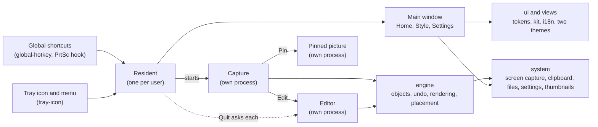

<p align="center">
  
</p>

<h1 align="center">Takeshot</h1>

<p align="center">
  Fast screenshot tool for Windows, macOS and Linux: capture with PrtSc, annotate with editable objects, add backgrounds and watermarks.
</p>

<p align="center">
  <a href="https://github.com/takeflow-oficial/takeshot/actions/workflows/ci.yml"></a>
  <a href="LICENSE"></a>
  <a href="https://github.com/takeflow-oficial/takeshot/stargazers"></a>
  <a href="https://github.com/takeflow-oficial/takeshot/releases/latest"></a>
</p>

<p align="center">
  <strong><a href="#english">English</a></strong> | <strong><a href="#portugues">Português</a></strong>
</p>

---

<a id="english"></a>

## What is Takeshot?

Takeshot lives in the tray. Press `PrtSc`, drag over what you want, mark it up with arrows, boxes, text, steps and blur, and copy or save a lossless PNG. Every mark stays an object you can select, move, restyle or delete, in the capture and in the editor. A style of your own (gradient background, margin, rounded corners, shadow, window bar, watermark) can go on every copy, so a screenshot is ready to post. Nothing is uploaded anywhere.

## Screenshots

Two themes over one layout, each in light and dark: **TakeUI** (purple) and **Coral UI** (coral).

<p align="center">
  
  
</p>
<p align="center">
  
  
</p>

## Features

**Capture**
- Area selection with a pixel loupe, coordinates and colour (`C` copies the hex under the cursor); handles, arrow keys and `Shift`+arrows adjust it, `Ctrl+A` takes the whole screen, and the last area can be remembered.
- Full screen straight into the editor, and a 3 second timer.
- The tools in a column beside the area, the options next to them and Pin, Save, Edit and Copy in a row under it; near a screen edge everything moves inward without covering the area.

**Annotation**
- Pen, line, arrow, rectangle (with rounded corners, 0 to 40 px), ellipse, highlighter, text, blur or pixelate, and numbered steps.
- `Shift` keeps 45° angles, squares and circles; `Alt` draws from the centre. A palette with a custom colour, five widths (the mouse wheel changes them), fill and opacity.
- Text in several system fonts, with or without a background box, edited in place with a caret, selection and paste.
- Every mark stays editable with any tool: over a shape the pointer becomes the move cross; `V` selects, `Shift`+click adds, the handles resize. Undo and redo cover everything, a whole drag being one step.

**Editor**
- A thin title bar with the file name, undo and redo, Pin, Save as, Save and Copy; zoom from 10 to 400 % around the pointer (`Ctrl`+wheel or pinch), and panning with space or the middle button.
- An Object tab (colour, width, corners, opacity, fill, font, the list of objects with show, hide and reorder) and a Style tab; a small bar over the selected object.
- Closing with changes not yet copied or saved asks first.

**Style**
- 12 ready gradients, a custom gradient, a solid colour, the capture itself blurred, or transparent; margin, rounded corners, shadow, a window bar and 16:9, 4:3, 1:1 and 9:16 formats.
- A watermark with a logo (PNG, JPG, WebP) and text: 9 positions or a top or bottom band, size, distance and opacity.
- Copying or saving straight from the capture can apply the full style, only the rounded corners, or nothing.

**Home and tray**
- Home lists the captures folder, newest first, in a grid or a list, each with its day; filters, search, a detail panel and the keyboard (arrows, `Enter`, `Ctrl+C`, `Del`). Thumbnails are cached, so a big folder opens fast from the second time on.
- The tray menu: capture area, full screen or in 3 seconds, the 5 recent captures (click copies, `Shift`+click edits), style, settings, theme, about and quit. Quit closes every Takeshot window, and an editor with changes asks first.
- Pin a capture over other windows: drag to move, drag an edge or a corner to resize, wheel to zoom, right-click for its menu.
- Start with the system, straight to the tray.

## How it works

1. Takeshot starts once and stays in the tray (a second launch only shows its window); the global shortcuts work with no window open.
2. `PrtSc` opens the capture over the screen; drag an area, draw on it, then copy, save, pin or open it in the editor.
3. The editor opens a capture or any picture (drag it onto Home, or paste it with `Ctrl+V`), keeps every mark editable, and applies the style you set in Style.
4. Captures go to your captures folder as lossless PNG at the screen's own resolution.

## Themes

Takeshot ships **TakeUI** and **Coral UI**, each light, dark or following the system, switched at once in Settings > General > Appearance (the sun and moon in the title bar toggle light and dark). A theme changes the colours, the brand mark and a few components, never where a function is. The language is Automatic, English or Português.

## Shortcuts

| Key | Action |
|---|---|
| `PrtSc` (Mac: `Ctrl+Shift+2`) | Capture an area |
| `Shift+PrtSc` (Mac: `Ctrl+Shift+1`) | Full screen |
| `P` `L` `A` `R` `O` `M` `T` `B` `N` | Pen, line, arrow, rectangle, ellipse, highlighter, text, blur, steps |
| `V` | Select: pick, move and resize objects, or move and adjust the area |
| `Delete` or `Backspace` | Delete the selected objects |
| `Ctrl+D` | Duplicate the selected objects |
| arrows / `Shift`+arrows | Move the selected objects 1 px / 10 px |
| `Ctrl+C` / `Ctrl+S` / `Ctrl+Shift+S` | Copy / save / save as (in the editor) |
| `Enter` or `Ctrl+E` | Open in the editor |
| `Ctrl+T` | Pin on screen |
| `Ctrl+Z` / `Ctrl+Y` or `Ctrl+Shift+Z` | Undo / redo |
| `Esc` | Close the capture (while typing, only end the text) |
| `Ctrl+0` / `Ctrl+1` / `Ctrl+=` / `Ctrl+-` | Editor: fit / 100 % / zoom in / zoom out |

The global shortcuts can be changed in Settings > Shortcuts. If `PrtSc` opens the Windows Snipping Tool, turn off Settings > Accessibility > Keyboard > "Use the Print screen key to open screen capture", or turn on Takeshot's "Use Takeshot priority" (a keyboard hook that takes `PrtSc` first; some antivirus programs dislike it). On Wayland an app cannot grab global keys: create a desktop shortcut that runs `takeshot --capture` (or `takeshot --capture --full`).

## Download

Get the latest version from [Releases](https://github.com/takeflow-oficial/takeshot/releases/latest):

| System | File |
|---|---|
| Windows 10 and 11 (x64) | `takeshot-<version>-windows-x64-setup.exe` (recommended: asks who to install for, just you with no administrator or everyone on the computer), `takeshot-<version>-windows-x64.msi`, or the portable `takeshot-<version>-windows-x64-portable.zip` |
| macOS 11+ (Apple Silicon and Intel) | `takeshot-<version>-macos-universal.dmg` |
| Linux x86_64 (glibc 2.39+: Ubuntu 24.04+, Debian 13+, Fedora 40+) | `takeshot-<version>-linux-x86_64.deb`, `takeshot-<version>-linux-x86_64.AppImage`, or `takeshot-<version>-linux-x86_64.tar.gz` |

The builds are not code-signed yet:
- **Windows**: SmartScreen may say it protected your PC. Click "More info" > "Run anyway". On Windows 10 the new tray icon starts hidden under the `^` arrow: drag it to the taskbar.
- **macOS**: the first time macOS blocks it. Open System Settings > Privacy & Security, click "Open Anyway" next to Takeshot and confirm (or run `xattr -cr /Applications/Takeshot.app`). Then allow it in Privacy & Security > Screen & System Audio Recording.
- **Linux**: the tray icon needs an AppIndicator panel (`libayatana-appindicator3-1`); without it, Quit is in Settings > General. On Wayland the notice after copying or saving is a desktop notification.

On Windows, the setup.exe's uninstaller stops Takeshot, removes its start-with-the-system entry (an update keeps it) and can delete its settings. The MSI installs for every user, asks for an administrator, and leaves the login entry behind.

## Architecture



One resident process per user owns the tray, the shortcuts and the main window. Captures, editors and pinned pictures run as processes of their own, register with the resident and answer its Quit. The drawing engine is shared by the capture and the editor; `views` draws every screen in both themes from the state kept in `screens`.

## Tech stack

| Area | Technology |
|---|---|
| Language | Rust (edition 2024) |
| UI | egui and eframe 0.37 (glow), Roboto and Lucide icons embedded |
| Rendering | tiny-skia, ab_glyph, image |
| Screen capture | xcap (Windows, macOS, X11) and the desktop portal (Wayland) |
| System | tray-icon, global-hotkey, arboard, interprocess, auto-launch, rfd, trash, notify-rust (Linux) |
| Packaging | cargo-packager (NSIS, WiX, app, deb, AppImage) and create-dmg (dmg) |
| CI | GitHub Actions: fmt, clippy and tests on Windows, macOS and Linux for every pull request; a one-button release builds the installers and publishes them |

## Project layout

```
src/
  main.rs        entry point: arguments, shared state, window modes
  engine/        drawing engine: objects, pointer policy, rendering, placement, presets
  system/        screen capture, clipboard and files, captures folder and thumbnails,
                 fonts, settings, and the resident's parts (tray, hotkeys, instance, autostart)
  ui/            design system: tokens per theme, kit, i18n, icons, brand, title bar, gallery
  screens/       window state and behaviour: home, editor, capture, pin, notice, shell
  views/         how the screens draw, in both themes
assets/          embedded fonts and the brand masters (SVG, PNG, ICO, ICNS)
packaging/       installers: the Windows NSIS template and pictures, the macOS Info.plist keys and dmg background
design/          takeshot-ui.fig (OpenPencil or Figma) and the exported references
docs/            README pictures, and the macOS and Linux test scripts
scripts/         check.sh (what CI runs), screenshots.sh, dev.sh, linux-packages.sh, linux-smoke.sh
```

## Building

```sh
cargo build --release
```

On Windows `rust-toolchain.toml` picks the MSVC toolchain. On Linux install first: `libgtk-3-dev libxcb1-dev libxcb-randr0-dev libxcb-shm0-dev libxkbcommon-dev libwayland-dev libdbus-1-dev libpipewire-0.3-dev libclang-dev libegl1-mesa-dev libgbm-dev`.

Installers: `cargo install cargo-packager --version 0.11.8 --locked`, then `cargo packager --release --formats nsis,wix` (Windows) or `scripts/linux-packages.sh` (deb and AppImage in a container; `scripts/linux-smoke.sh` opens them on X11 and Wayland, see [docs/testing-linux.md](docs/testing-linux.md)).

`takeshot --screenshot out.png` draws a window and saves its picture, with `--page inicio|estilo|ajustes|editor|captura`, `--theme takeui|coral`, `--mode light|dark` and `--lang en|pt`; `scripts/screenshots.sh` renders every screen in the four looks. `takeshot --minimized` starts in the tray only, and `takeshot --native-titlebar` (or `TAKESHOT_NATIVE_TITLEBAR=1`) uses the system's title bar, for the few graphics drivers that misplace clicks on a borderless window.

## Contributing

Contributions are welcome, by people and by AI agents alike: [AGENTS.md](AGENTS.md) holds the rules for both.

1. Branch `feat/<topic>` or `fix/<topic>` from `main`.
2. Keep `cargo fmt --check` and `cargo clippy --all-targets -- -D warnings` at zero, and `cargo test` green. `git config core.hooksPath .githooks` runs `scripts/check.sh` (the same checks, plus Linux and macOS in a container) before each push.
3. A visible change looks right in all four looks (TakeUI and Coral UI, light and dark): attach the screenshots from `scripts/screenshots.sh`.
4. Every user-facing string is a key in `src/ui/i18n.rs`, in English and Portuguese.
5. Write commit messages in [Conventional Commits](https://www.conventionalcommits.org/) and fill in the pull request template.

## License

Copyright (c) 2026 Takeflow Sistemas

Licensed under the [GNU Affero General Public License v3.0 or later](LICENSE). Third-party notices are in [THIRD_PARTY_NOTICES.md](THIRD_PARTY_NOTICES.md).

---

<a id="portugues"></a>

## O que é o Takeshot?

O Takeshot fica na bandeja. Aperte `PrtSc`, arraste sobre o que quer, marque com setas, caixas, texto, passos numerados e borrado, e copie ou salve um PNG sem perdas. Toda marca continua um objeto que dá para selecionar, mover, mudar de estilo ou excluir, na captura e no editor. Um estilo seu (fundo em degradê, margem, cantos arredondados, sombra, barra de janela, marca d'água) pode ir em cada cópia, e a captura já sai pronta para publicar. Nada é enviado para lugar nenhum.

## Capturas de tela

Dois temas sobre um layout só, cada um em claro e escuro: **TakeUI** (roxo) e **Coral UI** (coral).

<p align="center">
  
  
</p>
<p align="center">
  
  
</p>

## Funcionalidades

**Captura**
- Seleção de área com lupa de pixels, coordenadas e cor (`C` copia o hex sob o cursor); alças, setas e `Shift`+setas ajustam, `Ctrl+A` pega a tela inteira, e a última área pode ser lembrada.
- Tela inteira direto no editor e temporizador de 3 segundos.
- As ferramentas numa coluna ao lado da área, as opções ao lado delas e Fixar, Salvar, Editar e Copiar numa linha embaixo; perto da borda da tela, tudo passa para dentro sem cobrir a área.

**Anotação**
- Caneta, linha, seta, retângulo (com cantos arredondados, de 0 a 40 px), elipse, marcador, texto, borrar ou pixelar e passos numerados.
- `Shift` mantém ângulos de 45°, quadrados e círculos; `Alt` desenha a partir do centro. Paleta com cor personalizada, cinco espessuras (a roda do mouse troca), preenchimento e opacidade.
- Texto em várias fontes do sistema, com ou sem fundo, editado no lugar com cursor, seleção e colar.
- Toda marca continua editável com qualquer ferramenta: sobre uma forma o ponteiro vira a cruz de mover; `V` seleciona, `Shift`+clique soma, as alças redimensionam. Desfazer e refazer cobrem tudo, e um arraste inteiro é um passo só.

**Editor**
- Barra de título fina com o nome do arquivo, desfazer e refazer, Fixar, Salvar como, Salvar e Copiar; zoom de 10 a 400 % no ponteiro (`Ctrl`+roda ou pinça), e espaço ou o botão do meio arrastam a imagem.
- Aba Objeto (cor, espessura, cantos, opacidade, preenchimento, fonte, a lista de objetos com mostrar, ocultar e reordenar) e aba Estilo; uma barra pequena sobre o objeto selecionado.
- Fechar com mudanças que não foram copiadas nem salvas pergunta antes.

**Estilo**
- 12 degradês prontos, degradê personalizado, cor sólida, a própria captura borrada ou transparente; margem, cantos arredondados, sombra, barra de janela e formatos 16:9, 4:3, 1:1 e 9:16.
- Marca d'água com logo (PNG, JPG, WebP) e texto: 9 posições ou uma faixa em cima ou embaixo, com tamanho, distância e opacidade.
- Copiar ou salvar direto da captura pode aplicar o estilo completo, só os cantos arredondados ou nada.

**Início e bandeja**
- O Início lista a pasta das capturas, das mais novas para as mais antigas, em grade ou em lista, cada uma com o seu dia; filtros, busca, painel de detalhes e teclado (setas, `Enter`, `Ctrl+C`, `Del`). As miniaturas ficam em cache, então uma pasta grande abre rápido a partir da segunda vez.
- Menu da bandeja: capturar área, tela inteira ou em 3 segundos, as 5 capturas recentes (clique copia, `Shift`+clique edita), estilo, ajustes, tema, sobre e sair. Sair fecha todas as janelas do Takeshot, e um editor com mudanças pergunta antes.
- Fixar uma captura por cima das outras janelas: arrastar move, arrastar uma borda ou um canto muda o tamanho, a roda dá zoom, o botão direito traz o menu.
- Iniciar com o sistema, direto na bandeja.

## Como funciona

1. O Takeshot abre uma vez e fica na bandeja (abrir de novo só mostra a janela dele); os atalhos globais funcionam sem janela aberta.
2. `PrtSc` abre a captura sobre a tela; arraste uma área, desenhe nela e copie, salve, fixe ou abra no editor.
3. O editor abre uma captura ou qualquer imagem (arraste para o Início ou cole com `Ctrl+V`), mantém toda marca editável e aplica o estilo de Estilo.
4. As capturas vão para a sua pasta de capturas como PNG sem perdas, na resolução da própria tela.

## Temas

O Takeshot vem com **TakeUI** e **Coral UI**, cada um claro, escuro ou seguindo o sistema, trocados na hora em Ajustes > Geral > Aparência (o sol e a lua na barra de título alternam claro e escuro). O tema muda as cores, a marca e alguns componentes, nunca o lugar de uma função. O idioma é Automático, English ou Português.

## Atalhos

| Tecla | Ação |
|---|---|
| `PrtSc` (Mac: `Ctrl+Shift+2`) | Capturar área |
| `Shift+PrtSc` (Mac: `Ctrl+Shift+1`) | Tela inteira |
| `P` `L` `A` `R` `O` `M` `T` `B` `N` | Caneta, linha, seta, retângulo, elipse, marcador, texto, borrar, passos |
| `V` | Selecionar: escolher, mover e redimensionar objetos, ou mover e ajustar a área |
| `Delete` ou `Backspace` | Excluir os objetos selecionados |
| `Ctrl+D` | Duplicar os objetos selecionados |
| setas / `Shift`+setas | Mover os objetos selecionados 1 px / 10 px |
| `Ctrl+C` / `Ctrl+S` / `Ctrl+Shift+S` | Copiar / salvar / salvar como (no editor) |
| `Enter` ou `Ctrl+E` | Abrir no editor |
| `Ctrl+T` | Fixar na tela |
| `Ctrl+Z` / `Ctrl+Y` ou `Ctrl+Shift+Z` | Desfazer / refazer |
| `Esc` | Fechar a captura (digitando, só encerra o texto) |
| `Ctrl+0` / `Ctrl+1` / `Ctrl+=` / `Ctrl+-` | Editor: ajustar / 100 % / aproximar / afastar |

Os atalhos globais mudam em Ajustes > Atalhos. Se o `PrtSc` abrir a Ferramenta de Captura do Windows, desligue em Configurações > Acessibilidade > Teclado > "Usar a tecla Print Screen para abrir a captura de tela", ou ligue "Usar prioridade do Takeshot" (um gancho de teclado que pega o `PrtSc` antes; alguns antivírus estranham). No Wayland um app não pega teclas globais: crie um atalho do desktop que rode `takeshot --capture` (ou `takeshot --capture --full`).

## Download

Baixe a versão mais recente em [Releases](https://github.com/takeflow-oficial/takeshot/releases/latest):

| Sistema | Arquivo |
|---|---|
| Windows 10 e 11 (x64) | `takeshot-<versão>-windows-x64-setup.exe` (recomendado: pergunta para quem instalar, só você sem administrador ou todos no computador), `takeshot-<versão>-windows-x64.msi`, ou o portátil `takeshot-<versão>-windows-x64-portable.zip` |
| macOS 11+ (Apple Silicon e Intel) | `takeshot-<versão>-macos-universal.dmg` |
| Linux x86_64 (glibc 2.39+: Ubuntu 24.04+, Debian 13+, Fedora 40+) | `takeshot-<versão>-linux-x86_64.deb`, `takeshot-<versão>-linux-x86_64.AppImage`, ou `takeshot-<versão>-linux-x86_64.tar.gz` |

As versões ainda não são assinadas:
- **Windows**: o SmartScreen pode dizer que protegeu o computador. Clique em "Mais informações" > "Executar assim mesmo". No Windows 10 o ícone novo começa escondido na seta `^` da bandeja: arraste-o para a barra.
- **macOS**: na primeira vez o macOS bloqueia. Abra Ajustes do Sistema > Privacidade e Segurança, clique em "Abrir Mesmo Assim" ao lado do Takeshot e confirme (ou rode `xattr -cr /Applications/Takeshot.app`). Depois libere em Privacidade e Segurança > Gravação de Tela e Áudio do Sistema.
- **Linux**: o ícone da bandeja precisa de um painel com AppIndicator (`libayatana-appindicator3-1`); sem ele, Sair fica em Ajustes > Geral. No Wayland, o aviso ao copiar ou salvar é uma notificação do desktop.

No Windows, o desinstalador do setup.exe encerra o Takeshot, remove a entrada de iniciar com o sistema (uma atualização a mantém) e pode apagar as configurações. O MSI instala para todos os usuários, pede administrador e deixa a entrada de login.

## Arquitetura

Um processo residente por usuário cuida da bandeja, dos atalhos e da janela principal. Capturas, editores e imagens fixadas rodam em processos próprios, se registram no residente e respondem ao Sair dele. O motor de desenho é o mesmo na captura e no editor; `views` desenha todas as telas nos dois temas a partir do estado guardado em `screens`. O diagrama está na [seção em inglês](#architecture).

## Stack

| Área | Tecnologia |
|---|---|
| Linguagem | Rust (edition 2024) |
| Interface | egui e eframe 0.37 (glow), Roboto e ícones Lucide embutidos |
| Desenho | tiny-skia, ab_glyph, image |
| Captura de tela | xcap (Windows, macOS, X11) e o portal do desktop (Wayland) |
| Sistema | tray-icon, global-hotkey, arboard, interprocess, auto-launch, rfd, trash, notify-rust (Linux) |
| Instaladores | cargo-packager (NSIS, WiX, app, deb, AppImage) e create-dmg (dmg) |
| CI | GitHub Actions: fmt, clippy e testes em Windows, macOS e Linux em todo pull request; uma release de um botão gera os instaladores e publica |

## Estrutura do projeto

A árvore está na [seção em inglês](#project-layout): `engine/` (motor de desenho), `system/` (sistema e dados), `ui/` (design system), `screens/` (estado e comportamento das janelas), `views/` (como as telas desenham, nos dois temas), `assets/`, `packaging/`, `design/`, `docs/` e `scripts/`.

## Compilar

```sh
cargo build --release
```

No Windows o `rust-toolchain.toml` usa o toolchain MSVC. No Linux instale antes: `libgtk-3-dev libxcb1-dev libxcb-randr0-dev libxcb-shm0-dev libxkbcommon-dev libwayland-dev libdbus-1-dev libpipewire-0.3-dev libclang-dev libegl1-mesa-dev libgbm-dev`.

Instaladores: `cargo install cargo-packager --version 0.11.8 --locked`, depois `cargo packager --release --formats nsis,wix` (Windows) ou `scripts/linux-packages.sh` (deb e AppImage num container; `scripts/linux-smoke.sh` abre os dois no X11 e no Wayland, veja [docs/testing-linux.md](docs/testing-linux.md)).

`takeshot --screenshot saida.png` desenha uma janela e salva a imagem dela, com `--page inicio|estilo|ajustes|editor|captura`, `--theme takeui|coral`, `--mode light|dark` e `--lang en|pt`; `scripts/screenshots.sh` gera todas as telas nos quatro visuais. `takeshot --minimized` sobe só na bandeja, e `takeshot --native-titlebar` (ou `TAKESHOT_NATIVE_TITLEBAR=1`) usa a barra de título do sistema, para os poucos drivers de vídeo que deslocam os cliques numa janela sem borda.

## Contribuindo

Contribuições são bem-vindas, de pessoas e de agentes de IA: as regras para os dois estão no [AGENTS.md](AGENTS.md).

1. Crie a branch `feat/<tema>` ou `fix/<tema>` a partir da `main`.
2. Mantenha `cargo fmt --check` e `cargo clippy --all-targets -- -D warnings` zerados e `cargo test` verde. `git config core.hooksPath .githooks` roda o `scripts/check.sh` (as mesmas verificações, mais Linux e macOS num container) antes de cada push.
3. Uma mudança visível fica certa nos quatro visuais (TakeUI e Coral UI, claro e escuro): anexe as capturas do `scripts/screenshots.sh`.
4. Todo texto da interface é uma chave em `src/ui/i18n.rs`, em inglês e português.
5. Escreva as mensagens de commit em [Conventional Commits](https://www.conventionalcommits.org/) e preencha o template de PR.

## Licença

Copyright (c) 2026 Takeflow Sistemas

Licenciado sob a [GNU Affero General Public License v3.0 ou posterior](LICENSE). Avisos de terceiros em [THIRD_PARTY_NOTICES.md](THIRD_PARTY_NOTICES.md).
